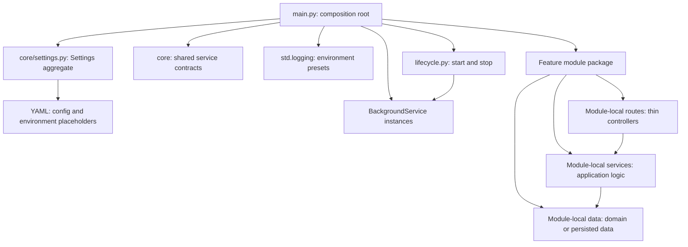

# Decisions and open questions

This page records the current architecture and product contract. **Decided**
means the implementation and user-facing documentation should follow the
choice. The configuration page owns the detailed behavior rules; this page
records the component boundaries and why they are used.

## Architecture choices

| Area | Current choice | Rationale and guardrail |
| --- | --- | --- |
| Distribution and import | The core PyPI distribution is `standard`; Python imports and the executable are named `std`. The CLI, skill, configuration, logging, and utility modules remain in `standard`. | Keep install, import, and executable names explicit. Do not split core or CLI into separate projects. |
| Core capability direction | The `standard` core includes configuration, logging, `Service`, `BackgroundService(Service)`, utility helpers, the `std` CLI, and packaged agent guidance. | Core owns shared lifecycle abstractions; the async service contract is implemented in `std.service` and covered by lifecycle tests. |
| Integration boundary | Publish independent distributions for FastAPI, AWS, HTTP, cache, and RDBMS, each under `std.<integration>`. Core extras select the matching providers. | Each integration distribution owns its subpackage and runtime dependencies; core must not import integration code. PyPI 0.1.1 still bundles FastAPI and AWS. The unreleased source now separates all five integrations. |
| Version and release | All six distributions use one annotated `vX.Y.Z` Git tag and one `release.yml` workflow. Versions come from `hatch-vcs`; release builds pin every cross-project requirement to that tag. | No per-distribution version fields or tags. CI verifies all 12 artifact versions and exact pins, then publishes core followed by providers. The tag selects the version; automation synchronizes it. |
| Configuration entry points | `ConfigManager` provides file loading and immutable mapping snapshots; Pydantic Settings source adapters provide typed model integration over the same loader. | Consumers can choose a direct mapping API or Pydantic model validation without maintaining two file-parsing implementations. |
| Configuration lifecycle | Parse and resolve sources when constructing or explicitly reloading; publish a new immutable `ConfigSnapshot` only after a successful load. | Repeated reads use prepared data. A failed reload must leave the last published snapshot intact. |
| Source pipeline | Parse each file, resolve interpolation, merge directory files deterministically, then expose the result. Pydantic source priority is a separate layer. | Do not conflate within-directory merge order with priority among init values, files, environment, dotenv, and secrets. See the [configuration contract](../configuration/index.md). |
| Error boundary | Raise public, source-aware configuration errors with locations when available; do not include configuration or environment values in messages. | Callers can identify the failing source while error output remains safe to log. |
| Agent interface | `std guide --format json` is a versioned machine-readable surface (`schema_version: 1`); the idiomatic Python skill is also available as a packaged resource. | Agents can discover install commands, supported modules, and docs without scraping prose. Evolve the JSON contract deliberately and update the CLI, tests, and API docs together. |
| Application module boundaries | Organize app code by feature, using Django-style module boundaries. Keep each feature's routes/controllers, schemas, domain or persistence models, services, repositories, and module-specific settings in its owning module. | A feature change should have one obvious home instead of being scattered across global layer folders. `core/` is only for capabilities shared across features; omit files and layers a feature does not need. |
| Logging configuration | `std.logging` uses Python's standard logging API with environment presets: readable console output for development/tests, JSON lines for staging/production, stdout by default, and typed per-setting overrides. | Applications get useful defaults without a logging dependency. A constrained formatter API keeps YAML declarative while custom format strings and named logger levels cover common advanced needs. |

## Application composition pattern

Applications built with Standard use explicit dependency injection and one
composition root. `main.py` constructs the application's settings, logger,
clients, services, and background services, then injects those dependencies
into routes and lifecycle management. Shared objects are created once at
startup so request handlers reuse them; `main.py` stays wiring-focused.

`core/settings.py` defines the top-level Pydantic `Settings` aggregate and YAML
loading setup. It references configuration models owned by their respective
feature modules and validates/builds their nested values from YAML instead of
redefining their fields. The application constructs `Settings()` only in
`main.py`. Environment-variable placeholders live in one YAML file, grouped by
module, and are resolved during YAML loading. Pydantic's direct environment and
dotenv sources must be customized away when they would provide a second path
into application settings.

Applications configure logging in that same composition root with
`std.logging.configure_logging`. The environment chooses sensible level and
format defaults, while explicit YAML settings can override them. The module
supports console, JSON, and custom standard-library formatters and writes to
stdout by default; see the [logging guide](../logging.md) for the field
contract and examples.

`lifecycle.py` receives constructed `BackgroundService` instances from
`main.py` and owns their startup and shutdown coordination. API routes act as
thin controllers, database models stay focused on persisted data, and
application workflows belong in services. Keep a feature's route, schema, data
model, service, repository, and configuration code in its module. The example
app template demonstrates this layout; features without persistence do not
need empty model or repository files.



## Distribution inventory and release plan

The following names define the intended PyPI projects and Python import
ownership. `standard` is the existing project. The five add-on source projects
are implemented in this repository but have not yet been published or reserved
on PyPI.

| PyPI project | Purpose and owned imports | Dependency boundary | State |
| --- | --- | --- | --- |
| `standard` | Core library, configuration, logging, utilities, `std` CLI, and packaged skill. | Base runtime dependencies only. Extras are convenience selectors for integrations. | Published as 0.1.1. Core and CLI remain here. |
| `standard-fastapi` | FastAPI integration at `std.fastapi`. | Depends on the matching `standard` release and FastAPI. | Implemented in source; PyPI returned 404 on 2026-10-12; publisher setup is owner action. |
| `standard-aws` | AWS integration at `std.aws`. | Depends on the matching `standard` release and aioboto3. | Implemented in source; PyPI returned 404 on 2026-10-12; publisher setup is owner action. |
| `standard-http` | HTTP client and authentication helpers at `std.http`. | Depends on the matching `standard` release and HTTPX. | Implemented in source; PyPI returned 404 on 2026-10-12; publisher setup is owner action. |
| `standard-cache` | Redis client, decorators, and locks at `std.cache`. | Depends on the matching `standard` release and Redis. | Implemented in source; PyPI returned 404 on 2026-10-12; publisher setup is owner action. |
| `standard-rdbms` | Relational database helpers at `std.rdbms`. | Depends on the matching `standard` release and SQLAlchemy/drivers. | Implemented in source; PyPI returned 404 on 2026-10-12; publisher setup is owner action. |

The target monorepo layout is:

```text
pyproject.toml                         # standard core and std CLI
src/std/                               # core-owned import files
packages/standard-fastapi/pyproject.toml
packages/standard-fastapi/src/std/fastapi/
packages/standard-aws/pyproject.toml
packages/standard-aws/src/std/aws/
packages/standard-http/pyproject.toml   # after its API and dependency design
packages/standard-http/src/std/http/
packages/standard-cache/pyproject.toml  # after its API and dependency design
packages/standard-cache/src/std/cache/
packages/standard-rdbms/pyproject.toml  # only after its API is designed
packages/standard-rdbms/src/std/rdbms/
```

Each add-on wheel must include only its own `std.<integration>` files. The
`standard` wheel owns `std/__init__.py` and core files; configure the root
build with an explicit core-file allow-list so it cannot scoop up integration
subpackages. Keep package ownership disjoint and verify combined installation
of the wheels before release.

The core distribution's five extras select their corresponding add-on
projects. Installing `standard` alone supplies only core modules; each
integration can also be installed directly. The published `v0.1.1` release
still bundles FastAPI and AWS. The next release uses one `vX.Y.Z` tag for all
six projects. A single workflow builds every wheel and source archive, verifies
their metadata, then publishes the core and providers in order. Release builds
pin the extras and provider core dependencies to that exact tag version, so
the convenience installs resolve one coordinated set.

Use `snake_case.py` for module and file names, `PascalCase` for classes, and
`snake_case` for functions and variables. Keep modules cohesive and avoid
root-level application files that shadow standard-library imports; namespaced
modules such as `std.logging` are fine. The packaged
[idiomatic Python skill](https://github.com/appunni-m/python-standard/blob/main/src/std/skills/standard-idiomatic-python/SKILL.md)
contains the full guidance for agents.

## Product and compatibility decisions

| Decision | Working contract |
| --- | --- |
| Python support | CPython 3.11–3.14; project metadata requires Python 3.11 or newer. |
| Base dependencies | PyYAML 6.x and pydantic-settings 2.x; TOML parsing uses the standard-library `tomllib`. |
| Optional extras | In published 0.1.1, FastAPI and AWS modules are bundled with `standard`. In the next release, all five extras select separate distributions, and the release build pins each to the same tag version. |
| Compatibility reference | Match documented and inspected behavior from `pydantic-settings-extra-sources` 0.1.0 where specified, while fixing the edge cases in the [configuration contract](../configuration/index.md). The reference package is test-only, not a runtime dependency. |
| Pydantic source priority | By default: init kwargs, config files, process environment, dotenv, then file secrets. Callers may customize the order. |
| Directory merge | Sort discovered files by normalized relative POSIX path; merge mappings recursively, append lists, and let later scalar or type conflicts replace earlier values. |
| Missing sources and YAML roots | Missing configured sources are errors unless explicitly optional. Empty YAML means `{}`; reject other non-mapping roots. |
| Interpolation | Resolve `${NAME}` and `${NAME:-default}` recursively in string values. An empty-but-set variable wins; detect cycles; `$$` escapes a literal dollar sign. JSON-decode only a whole-value interpolation. |
| Snapshots | Nested mappings are read-only and sequences are tuples. `to_dict()` returns an independent mutable copy. |
| License and docs hosting | MIT; publish the documentation site to GitHub Pages with GitHub Actions. |

## Open or deferred design questions

| Topic | Current status | Revisit when |
| --- | --- | --- |
| Environment profiles or environment-selected config files | Outside the compatibility baseline and not implemented. | A concrete use case defines selection, precedence, and failure semantics. |
| 100× configuration speed target | An aspiration, not an achieved result or release guarantee. Current checked-in measurements are historical exploratory data and are below that target. | A workload and end-to-end acceptance boundary are agreed; use the [benchmark plan](../configuration/benchmark-plan.md) and preserve equivalent behavior. |
| `Service` and `BackgroundService` contracts | Implemented in `std.service`: both use async lifecycle methods, `BackgroundService` extends `Service`, failed services remain cleanable, and worker failures are observable through state, `failure`, and `wait()`. | Revisit only when a concrete compatibility or operational gap is found. |
| Background startup policy | The app template registers each injected service's stop callback before calling start, so partial startup is cleaned up and services stop in reverse order. Background workers have a bounded graceful wait followed by cancellation and a second bounded wait. | Revisit if an application needs a different startup or shutdown policy. |

## Verified external setup

Status checked on 2026-10-12:

- The [PyPI `standard` project](https://pypi.org/project/standard/) lists
  maintainer `appunni-m` and release 0.1.1. Clean-environment install checks for
  the base package and optional extras passed; this verifies those install
  checks, not the unpublished repository version.
- GitHub Pages is enabled and the site is live at
  [appunni-m.github.io/python-standard](https://appunni-m.github.io/python-standard/).
- GitHub private vulnerability reporting is enabled through the repository's
  [Security Advisories page](https://github.com/appunni-m/python-standard/security/advisories).
- The annotated `v0.1.1` release workflow completed successfully and the GitHub
  release is live. This verifies Trusted Publishing for `standard`. The shared
  six-distribution workflow is configured in source; add-on publisher entries
  and the coordinated OIDC path are not yet verified. See the
  [publishing guide](../publishing.md).
